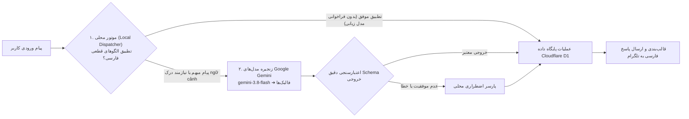
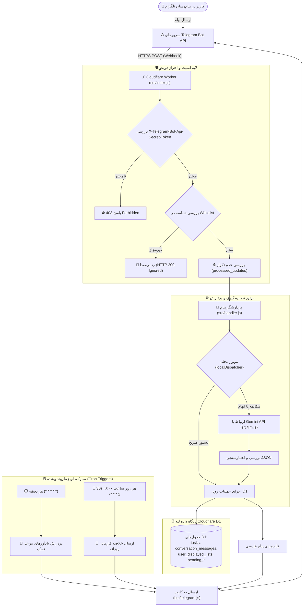

# هرمس مینی (Hermes Mini) 🚀
**دستیار هوشمند و سرورلس مدیریت کارهای روزانه به زبان فارسی بر بستر تلگرام**

[](https://workers.cloudflare.com/)
[-0051C3?logo=sqlite&logoColor=white)](https://developers.cloudflare.com/d1/)
[](https://ai.google.dev/)
[](https://core.telegram.org/bots/api)
[-6E9F18?logo=vitest&logoColor=white)](https://vitest.dev/)

---

## فهرست مطالب

- [۱. معرفی پروژه و هدف](#۱-معرفی-پروژه-و-هدف)
- [۲. امکانات و قابلیت‌های کلیدی](#۲-امکانات-و-قابلیت‌های-کلیدی)
- [۳. نمونه گفتگو با ربات](#۳-نمونه-گفتگو-با-ربات)
- [۴. نحوه پردازش هوشمند پیام‌ها (معماری Dual-Engine)](#۴-نحوه-پردازش-هوشمند-پیام‌ها-معماری-dual-engine)
- [۵. معماری پروژه و نمودار جریان داده](#۵-معماری-پروژه-و-نمودار-جریان-داده)
- [۶. فناوری‌ها و ابزارهای استفاده‌شده](#۶-فناوری‌ها-و-ابزارهای-استفاده‌شده)
- [۷. سیستم یادآوری و زمان‌بندی‌های Cron](#۷-سیستم-یادآوری-و-زمان‌بندی‌های-cron)
- [۸. امنیت، حریم خصوصی و جداسازی داده‌ها](#۸-امنیت-حریم-خصوصی-و-جداسازی-داده‌ها)
- [۹. ساختار پوشه‌ها و فایل‌ها](#۹-ساختار-پوشه‌ها-و-فایل‌ها)
- [۱۰. پیش‌نیازها و راهنمای نصب محلی](#۱۰-پیش‌نیازها-و-راهنمای-نصب-محلی)
- [۱۱. تنظیم متغیرهای محیطی و Secrets](#۱۱-تنظیم-متغیرهای-محیطی-و-secrets)
- [۱۲. نحوه اجرای تست‌های خودکار](#۱۲-نحوه-اجرای-تست‌های-خودکار)
- [۱۳. راهنمای استقرار روی Cloudflare (Deployment)](#۱۳-راهنمای-استقرار-روی-cloudflare-deployment)

---

## ۱. معرفی پروژه و هدف

پروژه **Hermes Mini** یک دستیار هوشمند، سبک و بدون سرور (Serverless) برای مدیریت تسک‌ها و یادآوری کارهای روزانه به زبان طبیعی فارسی است که بر بستر **Cloudflare Workers** و پایگاه داده توزیع‌شده لبه **Cloudflare D1** مستقر می‌شود.

هدف اصلی پروژه، حذف دستورات خشک اسلش (`/`) و دکمه‌های پیچیده و جایگزینی آن‌ها با تعاملی روان، طبیعی و انسان‌گونه است. کاربر می‌تواند همان‌گونه که با یک همکار گفتگو می‌کند، کارهای خود را با تاریخ‌های خورشیدی یا عبارات نسبی بیان کند، از سازوکار رفع ابهام ساعت بهره‌مند شود و فهرست وظایف خود را به آسانی مدیریت نماید.

این سیستم با تکیه بر معماری ابری لبه (Edge Computing)، ضمن ارائه پایداری بالا، جداسازی کامل حریم خصوصی کاربران و اجرای توزیع‌شده، بار پردازشی را بهینه می‌کند.

---

## ۲. امکانات و قابلیت‌های کلیدی

### 📝 ۱. ثبت تسک با فهم تقویم خورشیدی و زمان‌های نسبی
- **تاریخ‌های نسبی فارسی:** پشتیبانی از «امروز»، «فردا»، «پس‌فردا»، «امشب».
- **روزهای هفته به وقت تهران:** پشتیبانی از «شنبه»، «یکشنبه»، «دوشنبه»، «سه‌شنبه»، «چهارشنبه»، «پنج‌شنبه»، «جمعه».
- **تاریخ‌های صریح شمسی:** «۲۲ آبان»، «۱۵ اسفند ساعت ۱۱ صبح»، «۲۵ آذر ساعت ۸ شب».
- **قیدهای زمانی فارسی:** «صبح»، «ظهر»، «عصر»، «غروب»، «شب»، «بامداد».
- **رفع ابهام خودکار ساعت (۱۲ ساعته):** اگر کاربر ساعت را بدون قید صبح یا عصر بگوید (مثلاً «فردا ساعت ۵ باید برم کلاس زبان»)، ربات هوشمندانه می‌پرسد: *«منظورتان ساعت ۵ صبح است یا عصر؟»* و پس از دریافت پاسخ کاربر، تسک را دقیقاً ثبت می‌کند.
- **اعتبارسنجی بازه‌های زمانی:** ممانعت از ثبت تاریخ‌های منقضی‌شده در گذشته و ممانعت از ثبت موعدهای فراتر از یک سال تقویمی خورشیدی.

### 📋 ۲. مشاهده و فیلتر کارهای روزانه
- مشاهده با فیلترهای زمانی متنوع: «کارهای امروز»، «کارهای فردا»، «کارهای پس‌فردا»، «کارهای دوشنبه»، «کارهای ۲۲ آبان»، «کارهای عقب‌افتاده»، «کارهای انجام‌شده»، «لیست همه تسک‌ها».
- نمایش با آیکون‌های وضعیت یکپارچه:
  - 🟥 **موعدگذشته و انجام‌نشده** (Overdue)
  - ⬜️ **انجام‌نشده و موعدنگذشته** (Pending)
  - 🟩 **انجام‌شده** (Completed)

### 🔢 ۳. ارجاع ترتیبی و حافظه موقت ۳۰ دقیقه‌ای (Ordinal Indexing)
- ذخیره آخرین لیست نمایش‌داده‌شده به هر کاربر در جدول `user_displayed_lists` تا سقف ۳۰ دقیقه.
- امکان انجام عملیات با شماره یا واژه‌های ترتیبی:
  - «اولی رو انجام دادم»
  - «تسک دوم رو حذف کن»
  - «ساعت سومی رو ببر ۱۸:۰۰»

### ✏️ ۴. ویرایش و تغییر موعد تسک‌ها
- تغییر عنوان: «اسم تسک اول رو بذار خرید کتاب زبان»
- تغییر یا جابه‌جایی موعد: «ساعت خرید نان رو ببر فردا ساعت ۸ شب»
- حذف موعد زمانی: «موعد تسک دوم رو پاک کن»

### ✅ ۵. تغییر وضعیت تسک‌ها (Done / Undone)
- علامت‌گذاری انجام‌شده: «خرید نان انجام شد»، «تسک اول رو تیک بزن»
- بازگردانی به وضعیت فعال و انجام‌نشده: «تیک خرید نان رو بردار»، «اولی رو دوباره انجام‌نشده کن»

### 🗑️ ۶. حذف ایمن و تأیید دومرحله‌ای (Two-Step Confirmation)
- حذف تکی: «تسک خرید کتاب رو حذف کن»
- حفاظت در حذف دسته‌جمعی: دستوراتی مانند «همه تسک‌هام رو حذف کن» یا «همه کارهای انجام‌شده رو پاک کن» بلافاصله اجرا نمی‌شوند؛ ربات ابتدا پیام تأیید ارسال می‌کند و کاربر برای تأیید عبارت دقیق «بله همه را حذف کن» (یا «بله همه رو پاک کن») را ارسال کرده یا با عبارت «لغو کن» / «نه» آن را لغو می‌نماید.

### 💬 ۷. تفکیک مکالمات عادی از تسک‌ها
- ربات پیام‌های عمومی، احوال‌پرسی («سلام»، «چطوری»)، جوک، شعر، تعریف داستان کوتاه و پرسش‌های عمومی را درک کرده و پاسخ می‌دهد، بدون آنکه این پیام‌ها به اشتباه به تسک تبدیل شوند.

### 👥 ۸. قابلیت چندکاربره قابل پیکربندی (Multi-User Support)
- امکان تعریف شناسه مجاز تلگرام به‌صورت تک‌کاربره یا چندکاربره (با کاما در `ALLOWED_TELEGRAM_USER_ID`).
- تفکیک و ایزولاسیون کامل تسک‌ها، لیست‌ها، مکالمات و یادآورها بر اساس `telegram_user_id`.

---

## ۳. نمونه گفتگو با ربات

### سناریو ۱: ثبت تسک با زمان نسبی
```text
کاربر: سلام هرمس، برای فردا ساعت ۵ عصر تسک خرید شیر و نان رو ثبت کن
ربات: ✅ تسک با موفقیت ثبت شد:
📌 خرید شیر و نان
⏰ موعد: فردا ساعت ۱۷:۰۰
```

### سناریو ۲: تشخیص ساعت مبهم و رفع ابهام هوشمند
```text
کاربر: فردا ساعت ۵ باید برم کلاس زبان
ربات: منظورتان ساعت ۵ صبح است یا عصر؟
کاربر: عصر
ربات: ✅ تسک با موفقیت ثبت شد:
📌 برم کلاس زبان
⏰ موعد: فردا ساعت ۱۷:۰۰
```

### سناریو ۳: مشاهده لیست کارهای روز و ارجاع ترتیبی
```text
کاربر: کارهای امروز من چیه؟
ربات: 📅 کارهای امروز شما:

1. ⬜️ تحویل پروژه رایانش ابری (امروز ساعت ۱۴:۰۰)
2. ⬜️ مطالعه فصل سوم دیتابیس (امروز ساعت ۱۸:۳۰)

کاربر: اولی رو انجام دادم
ربات: 🎉 آفرین! تسک «تحویل پروژه رایانش ابری» انجام شد. ✅
```

### سناریو ۴: ویرایش موعد تسک
```text
کاربر: ساعت مطالعه فصل سوم رو ببر فردا ۹ شب
ربات: ✏️ تسک «مطالعه فصل سوم دیتابیس» ویرایش شد.
⏰ موعد جدید: فردا ساعت ۲۱:۰۰
```

### سناریو ۵: حذف گروهی تسک‌ها با تأیید امنیتی
```text
کاربر: همه تسک‌هام رو حذف کن
ربات: ⚠️ آیا مطمئن هستید که می‌خواهید تمام ۲ تسک خود را حذف کنید؟ این عملیات غیرقابل بازگشت است.

برای تأیید، عبارت «بله همه را حذف کن» را ارسال کنید.
برای لغو، عبارت «نه» یا «لغو کن» را بفرستید. (مهلت تأیید: ۲ دقیقه)

کاربر: بله همه را حذف کن
ربات: 🗑️ تمام ۲ تسک شما با موفقیت حذف شدند.
```

---

## ۴. نحوه پردازش هوشمند پیام‌ها (معماری Dual-Engine)

برای پردازش سریع و پایدار پیام‌ها، پروژه هرمس مینی از **موتور پردازش دوگانه** بهره می‌برد:



### ۱. موتور محلی قطعی (`src/localDispatcher.js`)
- دستورات پرتکرار و صریح (مانند لیست کردن تسک‌ها، تیک زدن، حذف، افزودن مستقیم تسک، ارجاع ترتیبی با «اولی/دومی»، و احوال‌پرسی‌های روتین) مستقیماً توسط این ماژول بدون ارسال درخواست به مدل زبانی پردازش می‌شوند.
- این سازوکار سبب کاهش وابستگی به شبکه خارجی و صرفه‌جویی در مصرف سهمیه API می‌شود.

### ۲. موتور مدل زبانی (`src/llm.js` - Google Gemini)
- پیام‌های پیچیده، ترکیبی، یا جملاتی که ساختار نگارشی محاوره‌ای و غیرخطی دارند، به هوش مصنوعی ارجاع داده می‌شوند.
- مدل خروجی را در قالب ساختار JSON تولید می‌کند که نیت (`intent`) و پارامترهای تسک (`task`) را استخراج می‌نماید.
- **زنجیره مدل‌های پشتیبان (Model Fallback Chain):**
  تنظیم‌شده در `wrangler.jsonc`:
  1. `gemini-3.8-flash` (مدل اصلی)
  2. `gemini-3.6-flash` (پشتیبان اول در صورت خطای موقت ۴۲۹ یا ۵xx)
  3. `gemini-3.5-flash-lite` (پشتیبان دوم سبک)
- **کنترل ضرب‌الاجل (Deadlines):**
  - حداکثر زمان مجاز کل زنجیره ۱۸ ثانیه است و هر تلاش حداکثر پس از ۸ ثانیه متوقف می‌گردد تا از بروز Timeout در ورکر جلوگیری شود.
- **اعتبارسنجی خروجی (`validateLlmOutput`):** خروجی خام مدل زبانی پیش از اجرا روی دیتابیس اعتبارسنجی می‌شود تا از یکپارچگی داده‌ها اطمینان حاصل گردد.

---

## ۵. معماری پروژه و نمودار جریان داده

پروژه هرمس مینی بر پایه معماری لبه (Edge Serverless) پیاده‌سازی شده است:



---

## ۶. فناوری‌ها و ابزارهای استفاده‌شده

| بخش / لایه | فناوری / ابزار | نقش در پروژه |
| :--- | :--- | :--- |
| **بستر ابری سرورلس** | [Cloudflare Workers](https://workers.cloudflare.com/) | اجرای کدهای جاوا اسکریپت روی لبه شبکه ابری |
| **پایگاه داده لبه** | [Cloudflare D1](https://developers.cloudflare.com/d1/) | دیتابیس رابطه‌ای توزیع‌شده بر پایه SQLite با پشتیبانی از تراکنش‌ها و ایندکس‌ها |
| **هوش مصنوعی (LLM)** | [Google Gemini](https://ai.google.dev/) | مدل اصلی `gemini-3.8-flash` به همراه فالبک‌های `gemini-3.6-flash` و `gemini-3.5-flash-lite` |
| **ارتباطات و وب‌هوک** | [Telegram Bot API](https://core.telegram.org/bots/api) | درگاه دریافت رویدادها از طریق Webhook امن و ارسال پیام‌ها |
| **ابزار توسعه و CLI** | [Wrangler 4.x](https://developers.cloudflare.com/workers/wrangler/) | ابزار رسمی کلودفلر برای اجرا، مدیریت Secretها و دیپلوی |
| **فریم‌ورک تست** | [Vitest](https://vitest.dev/) + `@cloudflare/vitest-plugin` | تست‌های خودکار در محیط شبیه‌سازی لبه و Cloudflare D1 |
| **تقویم و زمان‌بندی** | ماژول اختصاصی `src/dateUtils.js` | محاسبات تقویم جلالی/میلادی و منطقه زمانی تهران (`Asia/Tehran`) |

---

## ۷. سیستم یادآوری و زمان‌بندی‌های Cron

در فایل تنظیمات `wrangler.jsonc` دو محرک زمانی (Cron Triggers) تعریف شده‌اند:

```jsonc
"triggers": {
  "crons": [
    "* * * * *",
    "30 2 * * *"
  ]
}
```

### ۱. یادآوری دقیقه‌ای موعد تسک‌ها (`* * * * *`)
- **زمان اجرا:** در ابتدای هر دقیقه.
- **سازوکار قفل اتمیک (Atomic Lease Token):**
  برای ممانعت از ارسال پیام تکراری به کاربر در صورت اجرای هم‌زمان ورکر، ابتدا تسک با یک توکن تصادفی در دیتابیس قفل می‌شود (`reminder_status = 'claimed'`).
- **ارسال یادآور:** پیام هشدار موعد تسک مستقیماً به کاربر صاحب تسک ارسال می‌گردد.
- **مدیریت خطا و Backoff:** در صورت بروز خطای موقت شبکه یا محدودیت نرخ تلگرام (HTTP 429)، از مکانیزم Exponential Backoff با تنظیم فیلد `reminder_retry_after` استفاده می‌شود تا پیام در نوبت‌های بعدی مجدداً ارسال گردد.

### ۲. خلاصه کارهای صبحگاهی (`30 2 * * *`)
- **زمان اجرا:** ساعت ۰۲:۳۰ به وقت UTC معادل **۰۶:۰۰ صبح به وقت تهران**.
- **عملکرد:**
  - استخراج تمام تسک‌های موعد امروز (شامل تسک‌های در انتظار ⬜️ و تسک‌هایی که امروز از قبل انجام شده‌اند 🟩 تا وضعیت کلی روز کاربر مشخص باشد).
  - استخراج تسک‌های معوقه و عقب‌افتاده از روزهای قبل که هنوز انجام نشده‌اند (🟥).
  - ارسال پیام خلاصه صبحگاهی برای تمام کاربران مجاز به‌صورت مجزا.
  - در صورت خالی بودن برنامه، پیامی آرامش‌بخش برای آغاز روز ارسال می‌گردد.

---

## ۸. امنیت، حریم خصوصی و جداسازی داده‌ها

- **اعتبارسنجی امنیتی وب‌هوک:**
  درخواست‌های ورودی وب‌هوک تلگرام با هدر اختصاصی `X-Telegram-Bot-Api-Secret-Token` سنجیده می‌شوند. هرگونه درخواستی بدون این هدر با خطای `403 Forbidden` مسدود می‌گردد.
- **لیست مجاز کاربران (User Whitelist):**
  پروژه قابلیت پشتیبانی از یک یا چند شناسه مجاز تلگرام را از طریق `ALLOWED_TELEGRAM_USER_ID` دارد (شناسه‌ها به‌صورت کاما-جدا تنظیم می‌شوند).
- **رد بی‌صدا (Silent Drop):**
  پیام‌های ارسالی از سوی کاربران غیرمجاز بدون ارسال پاسخ، بدون ذخیره داده و بدون مصرف سهمیه هوش مصنوعی، به‌صورت بی‌صدا با پاسخ HTTP 200 نادیده گرفته می‌شوند تا اطلاعاتی درباره سامانه فاش نشود.
- **جداسازی کامل در سطح دیتابیس (Multi-Tenant Isolation):**
  تمامی جداول در D1 بر اساس ستون `telegram_user_id` ایندکس‌گذاری شده‌اند و تمامی کوئری‌های واکشی، ویرایش و حذف منحصراً دارای شرط `WHERE telegram_user_id = ?` هستند.
- **عدم نشت داده‌های محرمانه در لاگ‌ها:**
  متد `getSanitizedConfig` و اندپوینت پایش سلامت (`/health`) تنها وضعیت بولی یا تعداد شناسه‌های پیکربندی‌شده را گزارش می‌کنند و هیچ کلید، توکن یا شناسه‌ای در لاگ‌ها نشت پیدا نمی‌کند.

---

## ۹. ساختار پوشه‌ها و فایل‌ها

```plaintext
hermes-mini/
├── migrations/                                # اسکریپت‌های مایگریشن ساختار پایگاه داده D1
│   ├── 0003_create_context_and_dedup.sql      # جداول آیدمپوتنسی و لیست‌های نمایشی موقت
│   ├── 0004_fencing_and_idempotency.sql       # توکن‌های فنسینگ، نسخه‌بندی و وضعیت پردازش
│   └── 0005_task_reminders.sql                # فیلدهای وضعیت، قفل اجاره‌ای و زمان‌بندی یادآورها
├── src/                                       # کدهای اصلی برنامه
│   ├── config.js                              # ماژول اعتبارسنجی متغیرها و لیست سفید کاربران
│   ├── dateUtils.js                           # توابع تقویم جلالی، محاسبات منطقه زمانی تهران و نرمال‌سازی
│   ├── db.js                                  # لایه مخزن داده D1، اجرای کوئری‌های امن و قفل اتمیک
│   ├── handler.js                             # هماهنگ‌کننده پردازش پیام، رفع ابهام ساعت و تأییدیه‌ها
│   ├── index.js                               # ورودی اصلی Cloudflare Worker (هندلر وب‌هوک و Cron)
│   ├── llm.js                                 # ماژول ارتباط با Gemini، زنجیره Fallback و اعتبارسنجی JSON
│   ├── localDispatcher.js                     # موتور محلی پردازش قطعی دستورات بدون هوش مصنوعی
│   └── telegram.js                            # کلاینت ارسال پیام تلگرام و اعتبارسنجی وب‌هوک
├── test/                                      # سوئیت جامع آزمون‌های خودکار
│   ├── acceptance.spec.js                     # آزمون‌های سناریوهای کاربری واقعی
│   ├── dateUtils.spec.js                      # آزمون‌های تبدیل تاریخ و زمان خورشیدی
│   ├── handler.spec.js                        # آزمون‌های هسته پردازش پیام و فیلترها
│   ├── index.spec.js                          # آزمون‌های وب‌هوک، سلامت سرویس و کران‌ها
│   ├── localDispatcher.spec.js                # آزمون‌های موتور محلی بدون LLM
│   ├── multi_user.spec.js                     # آزمون‌های چندکاربره و ایزولاسیون داده‌ها
│   └── ...                                    # سایر فایل‌های آزمون‌های تخصصی و رگرسیون
├── package.json                               # وابستگی‌ها و اسکریپت‌های npm
├── vitest.config.mjs                          # پیکربندی Vitest با افزونه Cloudflare Workers
├── wrangler.jsonc                             # پیکربندی بایندینگ‌ها، متغیرها، پایگاه داده D1 و کران‌ها
└── README.md                                  # مستندات کامل پروژه
```

---

## ۱۰. پیش‌نیازها و راهنمای نصب محلی

### پیش‌نیازها:
- **Node.js:** نسخه `20.0.0` یا بالاتر
- **حساب Cloudflare:** برای ایجاد پایگاه داده D1 و استقرار ورکر
- **توکن ربات تلگرام:** ایجاد ربات در تلگرام از طریق [@BotFather](https://t.me/BotFather)
- **کلید API گوگل جمینای:** دریافت از [Google AI Studio](https://aistudio.google.com/)

### گام‌های راه‌اندازی محلی:

۱. دریافت نسخه پروژه (Clone) و ورود به پوشه:
```bash
git clone https://github.com/<YOUR_USERNAME>/hermes-mini.git
cd hermes-mini
```

۲. نصب بسته‌ها و وابستگی‌ها:
```bash
npm install
```

۳. ورود به حساب کاربری Cloudflare از طریق Wrangler:
```bash
npx wrangler login
```

---

## ۱۱. تنظیم متغیرهای محیطی و Secrets

متغیرهای عمومی و غیرحساس در بخش `vars` فایل [wrangler.jsonc](wrangler.jsonc) تنظیم شده‌اند:
- `DEFAULT_TIMEZONE`: `"Asia/Tehran"`
- `LLM_API_BASE`: `"https://generativelanguage.googleapis.com/v1beta/openai"`
- `LLM_MODEL`: `"gemini-3.8-flash"`
- `LLM_MODEL_FALLBACKS`: `"gemini-3.6-flash,gemini-3.5-flash-lite"`

اطلاعات محرمانه و کلیدها از طریق دستور `wrangler secret put` در محیط ابری ثبت می‌شوند:

```bash
# ۱. ثبت توکن ربات تلگرام (از BotFather دریافت می‌شود)
npx wrangler secret put TELEGRAM_BOT_TOKEN

# ۲. ثبت توکن محرمانه وب‌هوک (یک رشته تصادفی و امن)
npx wrangler secret put TELEGRAM_WEBHOOK_SECRET

# ۳. ثبت کلید دسترسی به هوش مصنوعی گوگل
npx wrangler secret put LLM_API_KEY

# ۴. ثبت شناسه‌های مجاز تلگرام (تک شناسه یا چند شناسه با کاما)
# مثال برای یک کاربر: 123456789
# مثال برای چند کاربر: 123456789,987654321
npx wrangler secret put ALLOWED_TELEGRAM_USER_ID
```

> [!TIP]
> برای پیدا کردن شناسه عددی تلگرام، می‌توانید در تلگرام به ربات‌هایی مانند [@userinfobot](https://t.me/userinfobot) پیام ارسال کنید.

---

## ۱۲. نحوه اجرای تست‌های خودکار

سوئیت تست‌های خودکار پروژه شامل **۴۷۲ تست در ۲۲ فایل آزمون** است که بخش‌های مختلف برنامه شامل توابع تقویم، مخزن دیتابیس D1، اعتبارسنجی خروجی مدل زبانی، امنیت وب‌هوک، ایزولاسیون چندکاربره و محرک‌های کران را اعتبارسنجی می‌کند:

```bash
# اجرای کلیه تست‌ها:
npx vitest run

# اجرای تست‌ها به‌صورت متوالی (توصیه‌شده برای محیط‌های با منابع محدود):
npx vitest run --no-file-parallelism

# اجرای تست‌ها در حالت مانیتورینگ تغییرات (Watch mode):
npm test
```

---

## ۱۳. راهنمای استقرار روی Cloudflare (Deployment)

### گام اول: ایجاد پایگاه داده Cloudflare D1
در ترمینال دستور زیر را اجرا کنید تا دیتابیس D1 در اکانت کلودفلر ایجاد شود:
```bash
npx wrangler d1 create hermes-mini-db
```
پس از ایجاد موفق، مقادیر `database_name` و `database_id` نمایش داده می‌شوند. شناسه پایگاه داده را در فایل [wrangler.jsonc](wrangler.jsonc) در بخش `d1_databases` قرار دهید.

### گام دوم: اعمال مایگریشن‌ها روی پایگاه داده ابری
```bash
npx wrangler d1 migrations apply hermes-mini-db --remote
```

### گام سوم: تنظیم Secretها
دستورات بخش ۱۱ را برای ثبت ۴ متغیر محرمانه اجرا کنید.

### گام چهارم: استقرار کدهای Worker
```bash
npx wrangler deploy
```
پس از اتمام، آدرس عمومی ورکر نمایش داده می‌شود (مانند `https://hermes-mini.<your-subdomain>.workers.dev`).

### گام پنجم: ست کردن وب‌هوک امن در تلگرام
آدرس ورکر و توکن امنیتی وب‌هوک را با دستور زیر به سرورهای تلگرام معرفی کنید:

```bash
curl -F "url=https://<YOUR_WORKER_DOMAIN>.workers.dev/webhook" \
     -F "secret_token=<YOUR_TELEGRAM_WEBHOOK_SECRET>" \
     https://api.telegram.org/bot<YOUR_TELEGRAM_BOT_TOKEN>/setWebhook
```

### گام ششم: بررسی سلامت سرویس
با باز کردن آدرس زیر در مرورگر یا فراخوانی آن با cURL، سلامت ارتباط با پایگاه داده و سرویس را بررسی کنید:
```bash
curl https://<YOUR_WORKER_DOMAIN>.workers.dev/health
```

نمونه خروجی استاندارد:
```json
{
  "status": "healthy",
  "service": "hermes-mini",
  "timestamp": "2026-11-08T22:00:00.000Z",
  "database": {
    "connected": true
  },
  "config": {
    "timezone": "Asia/Tehran",
    "hasAllowedUserId": true,
    "allowedUserCount": 2, // نمونه فرضی: تعداد شناسه‌های مجاز تنظیم‌شده
    "hasTelegramToken": true,
    "hasWebhookSecret": true,
    "hasLlmApiKey": true,
    "llmApiBase": "https://generativelanguage.googleapis.com/v1beta/openai",
    "llmModel": "gemini-3.8-flash",
    "llmModelFallbacks": [
      "gemini-3.6-flash",
      "gemini-3.5-flash-lite"
    ]
  }
}
```

ربات آماده دریافت پیام‌های فارسی شما در تلگرام است! 🚀
